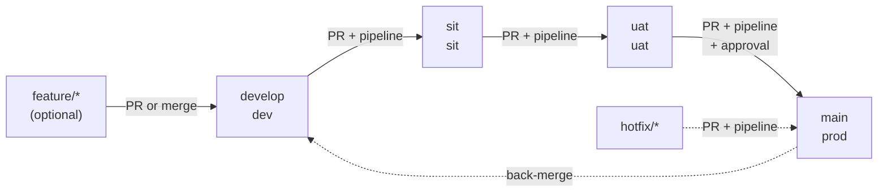

# Branching and environments

One repository, one long-lived branch per environment. Code is written on `develop` and promoted forward one environment at a time through pull requests. Each promotion runs the pipeline, and a merge deploys that environment.

## Environments

| Environment | Branch | Purpose | How code gets in | Deploys |
| --- | --- | --- | --- | --- |
| **dev** | `develop` | Day-to-day integration; always the newest code | Direct commits allowed, or PRs from `feature/*` | On every push |
| **sit** | `sit` | System integration testing: the full system (web, API, worker) against real Razorpay, WhatsApp and SMS sandboxes | PR from `develop` only | On merge |
| **uat** | `uat` | User acceptance testing: the centre owner or client signs off a release on production-like data | PR from `sit` only | On merge |
| **prod** | `main` | What real centres and parents use | PR from `uat` only | On merge, after approval |

`develop` is the only branch you can commit to directly. `sit`, `uat` and `main` accept changes only through a pull request that passes the pipeline.

## Flow



## Rules per branch

| Rule | `develop` | `sit` | `uat` | `main` |
| --- | --- | --- | --- | --- |
| Direct push | Allowed | Blocked | Blocked | Blocked |
| Pull request required | No | Yes | Yes | Yes |
| PR must come from | Anything | `develop` or `hotfix/*` | `sit` or `hotfix/*` | `uat` or `hotfix/*` |
| Required checks | None | `Build web`, `Promotion source` | `Build web`, `Promotion source` | `Build web`, `Promotion source` |
| Branch up to date before merge | No | Yes | Yes | Yes |
| Force-push or delete | Blocked | Blocked | Blocked | Blocked |
| Applies to admins | No | Yes | Yes | Yes |
| Deploy needs approval | No | No | No | Yes (`prod` environment reviewers) |

## Pipelines

All three live in `.github/workflows/`.

| Workflow | Runs on | What it does |
| --- | --- | --- |
| `ci.yml` (**CI** › `Build web`) | Every PR into any environment branch, and pushes to `develop` | Installs, type-checks and builds `apps/web` |
| `promotion-guard.yml` (**Promotion guard** › `Promotion source`) | PRs into `sit`, `uat`, `main` | Fails the PR unless it comes from the previous environment or a `hotfix/*` branch |
| `deploy.yml` (**Deploy**) | Pushes to `develop`, `sit`, `uat`, `main` (that is, merges) | Builds and deploys to the matching GitHub Environment: `dev`, `sit`, `uat` or `prod` |

The deploy step is a placeholder until hosting is chosen. Put each environment's deploy target and keys in **Settings › Environments › \<env\> › Secrets**, so the same workflow publishes to different places per branch.

As the API and worker gain code, add their build and test steps to `ci.yml` as more jobs, and add those job names to the required checks.

## Day-to-day work

**Small change straight to dev:**

```sh
git switch develop
git pull
# edit, then
git commit -am "Add batch filter to students list"
git push                         # deploys to dev
```

**Larger change (recommended):** branch off `develop` as `feature/<short-name>`, push it, and open a PR into `develop`. CI runs on the PR.

**Promote dev → sit:** on GitHub, open a PR with base `sit` and compare `develop`. Title it like `Promote to SIT: <date or version>`. Merge once `Build web` and `Promotion source` are green. Use a **merge commit**, not squash, so the branches keep a shared history and later promotions show only new commits.

**Promote sit → uat**, then **uat → main**, the same way. The merge to `main` waits for a reviewer to approve the `prod` deployment.

## Hotfixes

For a production bug that can't wait for the normal flow:

1. Branch from `main`: `git switch -c hotfix/<short-name> origin/main`.
2. Fix it, push, and open a PR into `main`. The pipeline runs, and the guard allows `hotfix/*`.
3. After it merges, bring the fix back down so it isn't lost on the next promotion: open PRs from `main` (or the same `hotfix/*` branch) into `uat`, `sit` and `develop`, or merge `main` into `develop` directly.

## Naming

| Kind | Pattern | Example |
| --- | --- | --- |
| Feature | `feature/<short-name>` | `feature/whatsapp-reminders` |
| Bug fix (normal flow) | `fix/<short-name>` | `fix/overdue-late-fee` |
| Hotfix to prod | `hotfix/<short-name>` | `hotfix/receipt-pdf-crash` |
| Promotion PR title | `Promote to <ENV>: <date or version>` | `Promote to UAT: 2026-11-02` |

## One-time GitHub setup

`scripts/setup-github-branches.sh` creates `develop`, `sit` and `uat` from `main`, makes `develop` the default branch, creates the four GitHub Environments, and applies the rules above.

```sh
brew install gh
gh auth login
scripts/setup-github-branches.sh                # 0 required approvals (solo)
REVIEWS=1 scripts/setup-github-branches.sh      # once there is a second reviewer
```

Then, under **Settings › Environments › prod**, add yourself as a **Required reviewer**.

This setup has been applied to `sejaltech994/coaching-centre-fee-app`. The repository is **public**, so GitHub enforces branch protection on the Free plan.

> **If the repository is made private again**, GitHub enforces branch protection there only on the **Pro**, **Team** or **Enterprise** plans. On Free, the rules stop being enforced and the script's protection step fails with a 403. Because the repo is public, never commit secrets: keep them in `.env` (git-ignored) and in GitHub Environment secrets.

With one reviewer required, you can't approve your own PR. That's why `REVIEWS` defaults to 0: a PR and a green pipeline are still required.
