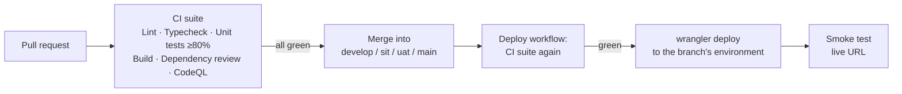

# CI/CD

Every change reaches an environment the same way: a pull request runs the full check suite, the merge reruns it, and only then does the deploy start. A smoke test checks the live site after every deploy.



## Pull request checks

All of these are **required status checks**: GitHub blocks the merge until each one passes, for admins too.

| Check | Workflow | What fails it |
| --- | --- | --- |
| **Lint** | `ci.yml` | Any ESLint error **or warning** (`next/core-web-vitals` + TypeScript rules) |
| **Typecheck** | `ci.yml` | Any TypeScript error (`tsc --noEmit`) |
| **Unit tests** | `ci.yml` | A failing test, or coverage below the minimum (below) |
| **Build web** | `ci.yml` | `next build` fails to produce the static site |
| **Dependency review** | `ci.yml` | The PR adds a dependency with a known **high or critical** vulnerability, or under AGPL-3.0, GPL-3.0 or SSPL-1.0 |
| **CodeQL** | `codeql.yml` | Code scanning (`security-extended` queries) finds a new security issue |
| **Promotion source** | `promotion-guard.yml` | Into `sit`/`uat`/`main` only: the PR doesn't come from the previous environment or a `hotfix/*` branch |

The unit-test job writes a coverage table to the run's summary page and uploads the full HTML report as the `coverage-web` artifact, kept for 14 days.

## Test coverage requirements

| Metric | Minimum |
| --- | --- |
| Lines | 80% |
| Statements | 80% |
| Functions | 80% |
| Branches | 80% |

- **Where it's set:** `thresholds` in each workspace's `vitest.config.mts` (`apps/web`, `apps/api`, `packages/shared`, `packages/db`, `packages/integrations`). Every workspace must meet the minimum on its own; one well-tested package can't carry another. Vitest exits with an error when any metric is below its minimum, so **Unit tests** fails.
- **What counts:** all source under each workspace's `src`, except tests and three entry points that only wire real infrastructure together: `apps/web/src/app/layout.tsx` (`next/font`), `apps/api/src/server.ts` (HTTP server) and `packages/db/src/migrate.ts` (migration CLI).
- **Raising the bar:** raise a threshold once coverage sits comfortably above it. Never lower one to get a PR through. Add tests instead.
- **Test-first:** features are built test-first (red → green → refactor). Tests describe behaviour (what the user sees and does, what the API returns), not markup or internals.
- **Database tests** run real SQL migrations against an in-memory Postgres (PGlite, `@chukta/db/testing`), so constraints and queries are tested for real, with no Docker.

## Run the checks locally

Needs Node 22.13 or newer (`.nvmrc` says 22). From the repo root, each command runs across every workspace:

```sh
npm run lint
npm run typecheck
npm run test:coverage     # or, inside one workspace: npm run test -- --watch
npm run build
```

## Deployment

`deploy.yml` runs on every push to `develop`, `sit`, `uat` and `main`, which in practice means every merged PR:

1. **Checks:** calls `ci.yml` and reruns the whole suite on the merged code.
2. **Deploy:** only if the checks pass. Builds the site, marks non-prod as `noindex`, and runs `wrangler deploy --env <env>`. Prod waits for a reviewer on the `prod` environment.
3. **Smoke test:** the live URL must return 200, serve the landing page, send the security headers, and return 404 for unknown paths. Otherwise the run fails.

Hosting, URLs, secrets and rollback are in [deployment.md](deployment.md).

## Keeping dependencies current

Dependabot (`.github/dependabot.yml`) opens PRs into `develop` every Monday:

- npm packages in `apps/web`, with minor and patch updates grouped into one PR
- GitHub Actions versions

They pass the same checks as any other PR. Major upgrades arrive one per PR, so they can be reviewed on their own.

## Changing the required checks

The list lives in `CHECKS` at the top of `scripts/setup-github-branches.sh`. After renaming or adding a CI job, update that list and rerun the script, or edit **Settings › Branches** for each of the four branches.
