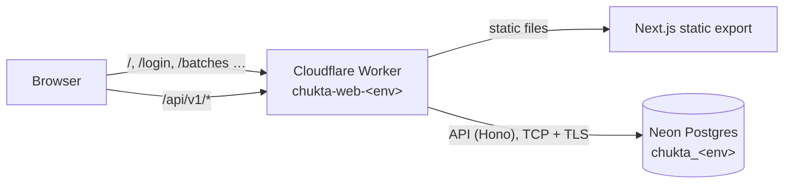

# Deployment

Each environment is **one Cloudflare Worker** that serves both the web app (static files from the Next.js export) and the API at `/api/*` (`apps/api/src/worker.ts`), backed by that environment's own **Neon Postgres** database. Every deploy is automatic when code lands on the environment's branch.

| Environment | Branch | Worker and URL | Database | API |
| --- | --- | --- | --- | --- |
| dev | `develop` | `chukta-web-dev`, https://chukta-web-dev.chukta.workers.dev | `chukta_dev` (non-prod project) | **Live**; login codes in the Worker log |
| sit | `sit` | `chukta-web-sit`, https://chukta-web-sit.chukta.workers.dev | `chukta_sit` (non-prod project) | Ready; goes live on the first promotion to `sit` |
| uat | `uat` | `chukta-web-uat`, https://chukta-web-uat.chukta.workers.dev | `chukta_uat` (non-prod project) | Ready; goes live on the first promotion to `uat` |
| prod | `main` | `chukta-web-prod`, https://chukta-web-prod.chukta.workers.dev (custom domain later) | Own Neon project in Mumbai (not created yet) | **Off (503)** until real SMS (MSG91, DLT-registered) is set up |

### Databases

| | Non-production (dev, sit, uat) | Production |
| --- | --- | --- |
| Neon project | Existing project, AWS US East 2 (Ohio), PostgreSQL 18 | Separate project, **AWS Asia Pacific 1 (Mumbai)**, created before launch |
| Databases | `chukta_dev`, `chukta_sit`, `chukta_uat`: one per environment, on one compute | One database, own compute |
| Credentials | Shared non-prod owner role | Its own role and password, never used anywhere else |
| `JWT_SECRET` | Different per environment | Its own |

Each environment has its own database and token secret, so data and sessions never cross between environments. Production is a separate project, so a leaked non-production credential can never reach live centres' data, and Indian centres' data stays in India.

**Non-prod is in Ohio, not Mumbai**, which adds latency and isn't where Indian data should live long term. That's fine for dev, sit and uat while there is no real data. Move them to a Mumbai project when convenient: create it, then update the three `DATABASE_URL` secrets.



## Why this setup

- **Same origin for site and API.** The refresh token lives in an `HttpOnly; Secure; SameSite=Strict` cookie. A separate API address on `*.workers.dev` would be a different *site*, and browsers would drop that cookie. Serving `/api/*` from the site's own Worker keeps it first-party, with no CORS.
- **Free until launch, commercial use allowed.** Workers: static files free and unlimited, 100,000 API requests/day ([pricing](https://developers.cloudflare.com/workers/platform/pricing/)). Neon free: 0.5 GB per project, branches per environment, scales to zero when idle ([pricing](https://neon.com/pricing)).
- **Secure by default.** HTTPS, DDoS protection, security headers (`apps/web/public/_headers`). dev, sit and uat send `X-Robots-Tag: noindex`. Secrets live only in GitHub environment secrets and Worker secrets. Database traffic is TLS. Tenant isolation is enforced in the database by row-level security.
- **India region for production.** The prod project lives in Neon's AWS Asia Pacific (Mumbai) region, keeping live data and latency local.

## What each deploy does

`.github/workflows/deploy.yml`, on every push to `develop`, `sit`, `uat` or `main`:

1. **Checks:** the full CI suite (lint, types, unit tests, build, E2E, security scans).
2. **Build:** the web app, set to call the API at `/api/v1` on its own origin.
3. **Migrate:** `npm run db:migrate -w packages/db` against the environment's `DATABASE_URL`. This runs before the new code goes live, and migrations only add.
4. **Deploy:** `wrangler deploy --env <env>`.
5. **Secrets:** `DATABASE_URL` and `JWT_SECRET` copied from the GitHub environment into the Worker (`wrangler secret bulk`). To rotate one, change it in GitHub and re-run the deploy.
6. **Smoke test:** the site, its security headers and 404s, then `/api/v1/health/ready`, which checks the API can reach its database (not for prod while its API is off).

If an environment's `DATABASE_URL` or `JWT_SECRET` is missing, the site still deploys, the pipeline warns, and that environment's API answers `503 misconfigured`.

## One-time setup

### Cloudflare (done)

The account, workers.dev subdomain `chukta`, `account_id` in `apps/web/wrangler.jsonc`, and the `CLOUDFLARE_API_TOKEN` repository secret (token permissions: **Account › Workers Scripts › Edit**, **Account › Account Settings › Read**) are in place.

### Neon: non-production (done)

`chukta_dev`, `chukta_sit` and `chukta_uat` exist, and each GitHub environment (`dev`, `sit`, `uat`) holds its `DATABASE_URL` and its own `JWT_SECRET`. Each deploy migrates its database. sit and uat get their Workers on the first promotion PR to those branches.

Connection strings use the **direct** host (no `-pooler`) and `sslmode=require`, without `channel_binding`, which Cloudflare Workers can't do.

### Neon: production (before launch)

1. In [console.neon.tech](https://console.neon.tech), **New project**: name `chukta-prod`, latest Postgres, region **AWS Asia Pacific 1 (Mumbai)**.
2. **Connect**: role `neondb_owner`, database `neondb`, **direct** connection (switch off *Connection pooling*). Copy the string and remove `&channel_binding=require` from the end.
3. Store it, and a new JWT secret, in the `prod` environment. Each prompts, so values never land in shell history:

   ```sh
   gh secret set DATABASE_URL --env prod
   openssl rand -base64 48 | tr -d '\n' | gh secret set JWT_SECRET --env prod
   ```

The next deploy to `main` migrates it. Its API stays off until real SMS is configured.

### Rotating a database password

If a connection string is ever exposed (pasted in chat, logged, committed), reset it: **Neon › Roles › neondb_owner › Reset password**, then for each environment that uses it:

```sh
gh secret set DATABASE_URL --env dev    # paste the new string; repeat for sit, uat
gh workflow run deploy.yml --ref develop
```

## Day to day

- **Log in on hosted dev, sit or uat:** SMS isn't connected yet, so the 6-digit code goes to the Worker's log. In Cloudflare, open **Workers & Pages › chukta-web-dev › Logs › Live** (or run `npx wrangler tail --env dev` in `apps/web`), press **Get OTP**, and read the code from the line `[sms:console] Chukta login code for +91******1234: 482913`.
- **Browse the data:** the Neon console's **Tables** and **SQL Editor**, or `DATABASE_URL=<branch URL> npm run db:studio -w packages/db`.
- **Roll back the code:** **Workers & Pages › chukta-web-<env> › Deployments**, then promote an earlier version, or revert the commit and let the pipeline redeploy.
- **Roll back data:** Neon keeps history for the free plan's restore window. Use **Branches › Restore** to a point in time.
- **Prod deploys** wait for approval under **Settings › Environments › prod**.

## Hardening (optional, still free)

- **Lock sit and uat to the team.** Cloudflare Zero Trust is free for up to 50 users. Add an **Access** application for `chukta-web-sit.*` and `chukta-web-uat.*` that allows only your team's emails.
- **Custom domain for prod.** Add the domain to Cloudflare, then set `routes` (or `custom_domain`) under `env.prod` in `apps/web/wrangler.jsonc`, and update its `WEB_ORIGINS`.

## Later

- **Real SMS** (MSG91 or similar) needs DLT registration of the sender ID and template. Production's API turns on once it's configured.
- **Background jobs** (`apps/worker`, BullMQ): Upstash Redis free gives 1 database and 500K commands/month ([pricing](https://upstash.com/pricing/redis)). BullMQ polls Redis constantly, so budget for pay-as-you-go before prod, or use Cloudflare Queues and Cron Triggers instead.

## Performance

Measured on dev (Worker served from Singapore, database in Ohio, ~220 ms apart) before tuning: **2.3 s** for one query, **3.5 s** to list batches, **4 s** to save one, **5.5 s** to edit one. Almost all of it was database round trips, about 6 to open a fresh connection plus several per transaction. What keeps it fast:

| Setting | Where | Effect |
| --- | --- | --- |
| **Targeted placement** next to the database | `placement` per env in `apps/web/wrangler.jsonc` (`aws:us-east-2` for non-prod; prod's will be Mumbai) | Each database round trip is a few ms instead of ~220 ms; only the visitor → Worker hop stays long |
| **Hyperdrive** connection pooling, **query cache off** | `hyperdrive` binding per env (configs `chukta-dev`, `chukta-sit`, `chukta-uat`) | No TCP + TLS + login per request. The cache stays off because writes don't invalidate it, which would show stale lists |
| One statement to scope a transaction to a centre | `withCentre` in `packages/db` | One round trip instead of two per transaction |
| Edit and archive in one transaction | `apps/api/src/modules/batches/routes.ts` | Half the transactions per save |
| Token first, centre cached between pages | `useSession` in `apps/web` | Pages load their data in parallel and don't refetch the centre on every page |

Hyperdrive holds its own copy of each database's credentials. **After rotating a Neon password, update the Hyperdrive config too** (Cloudflare › Storage & Databases › Hyperdrive › `chukta-<env>` › Edit), as well as the `DATABASE_URL` secret.
