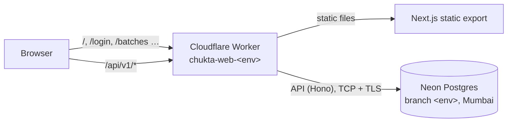

# Deployment

Each environment is **one Cloudflare Worker** that serves both the web app (static files from the Next.js export) and the API at `/api/*` (`apps/api/src/worker.ts`), backed by that environment's **Neon Postgres** branch. Every deploy is automatic when code lands on the environment's branch.

| Environment | Branch | Worker and URL | Database (Neon branch) | API |
| --- | --- | --- | --- | --- |
| dev | `develop` | `chukta-web-dev`, https://chukta-web-dev.chukta.workers.dev | `dev` | On; login codes in the Worker log |
| sit | `sit` | `chukta-web-sit`, https://chukta-web-sit.chukta.workers.dev | `sit` | On; login codes in the Worker log |
| uat | `uat` | `chukta-web-uat`, https://chukta-web-uat.chukta.workers.dev | `uat` | On; login codes in the Worker log |
| prod | `main` | `chukta-web-prod`, https://chukta-web-prod.chukta.workers.dev (custom domain later) | `main` | **Off (503)** until real SMS (MSG91, DLT-registered) is set up |



## Why this setup

- **Same origin for site and API.** The refresh token lives in an `HttpOnly; Secure; SameSite=Strict` cookie. A separate API address on `*.workers.dev` would be a different *site*, and browsers would drop that cookie. Serving `/api/*` from the site's own Worker keeps it first-party, with no CORS.
- **Free until launch, commercial use allowed.** Workers: static files free and unlimited, 100,000 API requests/day ([pricing](https://developers.cloudflare.com/workers/platform/pricing/)). Neon free: 0.5 GB per project, branches per environment, scales to zero when idle ([pricing](https://neon.com/pricing)).
- **Secure by default.** HTTPS, DDoS protection, security headers (`apps/web/public/_headers`). dev, sit and uat send `X-Robots-Tag: noindex`. Secrets live only in GitHub environment secrets and Worker secrets. Database traffic is TLS. Tenant isolation is enforced in the database by row-level security.
- **India region.** Neon's AWS Asia Pacific (Mumbai) region keeps data and latency local.

## What each deploy does

`.github/workflows/deploy.yml`, on every push to `develop`, `sit`, `uat` or `main`:

1. **Checks:** the full CI suite (lint, types, unit tests, build, E2E, security scans).
2. **Build:** the web app, set to call the API at `/api/v1` on its own origin.
3. **Migrate:** `npm run db:migrate -w packages/db` against the environment's `DATABASE_URL`. This runs before the new code goes live, and migrations only add.
4. **Deploy:** `wrangler deploy --env <env>`.
5. **Secrets:** `DATABASE_URL` and `JWT_SECRET` copied from the GitHub environment into the Worker (`wrangler secret bulk`). To rotate one, change it in GitHub and re-run the deploy.
6. **Smoke test:** the site, its security headers and 404s, then `/api/v1/health/ready`, which checks the API can reach its database (not for prod while its API is off).

If an environment's `DATABASE_URL` or `JWT_SECRET` is missing, the site still deploys, the pipeline warns, and that environment's API answers `503 misconfigured`.

## One-time setup

### Cloudflare (done)

The account, workers.dev subdomain `chukta`, `account_id` in `apps/web/wrangler.jsonc`, and the `CLOUDFLARE_API_TOKEN` repository secret (token permissions: **Account › Workers Scripts › Edit**, **Account › Account Settings › Read**) are in place.

### Neon (per environment)

1. Sign up free at [console.neon.tech](https://console.neon.tech/signup) (GitHub or Google sign-in is fine).
2. **Create project**: name `chukta`, Postgres **17**, region **AWS Asia Pacific 1 (Mumbai)**. The project's default branch `main` is **prod**.
3. **Branches › New branch** from `main`: create `dev` now, then `sit` and `uat` when those environments are first needed.
4. For each branch: **Connect**, pick the branch, role `neondb_owner`, database `neondb`, and copy the connection string. It looks like `postgresql://neondb_owner:…@ep-….ap-south-1.aws.neon.tech/neondb?sslmode=require`. Use the plain (direct) one, not the `-pooler` one: migrations and the API use transactions with `SET LOCAL`.

### GitHub environment secrets (per environment)

From the repo root, for each environment (`dev` first). Each command prompts for the value, so it never lands in your shell history:

```sh
gh secret set DATABASE_URL --env dev     # paste the dev branch's connection string
openssl rand -base64 48                  # make a JWT secret; copy the output
gh secret set JWT_SECRET --env dev       # paste it
```

Use a **different** `JWT_SECRET` per environment, so a token from dev can never work on prod.

Then deploy (merging to `develop` does it, or by hand):

```sh
gh workflow run deploy.yml --ref develop
gh run watch
```

## Day to day

- **Log in on hosted dev, sit or uat:** SMS isn't connected yet, so the 6-digit code goes to the Worker's log. In Cloudflare, open **Workers & Pages › chukta-web-dev › Logs › Live** (or run `npx wrangler tail --env dev` in `apps/web`), press **Get OTP**, and read the code from the line `[sms:console] Chukta login code for +91******1234: 482913`.
- **Browse the data:** the Neon console's **Tables** and **SQL Editor**, or `DATABASE_URL=<branch URL> npm run db:studio -w packages/db`.
- **Roll back the code:** **Workers & Pages › chukta-web-<env> › Deployments**, then promote an earlier version, or revert the commit and let the pipeline redeploy.
- **Roll back data:** Neon keeps history for the free plan's restore window. Use **Branches › Restore** to a point in time.
- **Prod deploys** wait for approval under **Settings › Environments › prod**.

## Hardening (optional, still free)

- **Lock sit and uat to the team.** Cloudflare Zero Trust is free for up to 50 users. Add an **Access** application for `chukta-web-sit.*` and `chukta-web-uat.*` that allows only your team's emails.
- **Custom domain for prod.** Add the domain to Cloudflare, then set `routes` (or `custom_domain`) under `env.prod` in `apps/web/wrangler.jsonc`, and update its `WEB_ORIGINS`.

## Later

- **Real SMS** (MSG91 or similar) needs DLT registration of the sender ID and template. Production's API turns on once it's configured.
- **Background jobs** (`apps/worker`, BullMQ): Upstash Redis free gives 1 database and 500K commands/month ([pricing](https://upstash.com/pricing/redis)). BullMQ polls Redis constantly, so budget for pay-as-you-go before prod, or use Cloudflare Queues and Cron Triggers instead.
